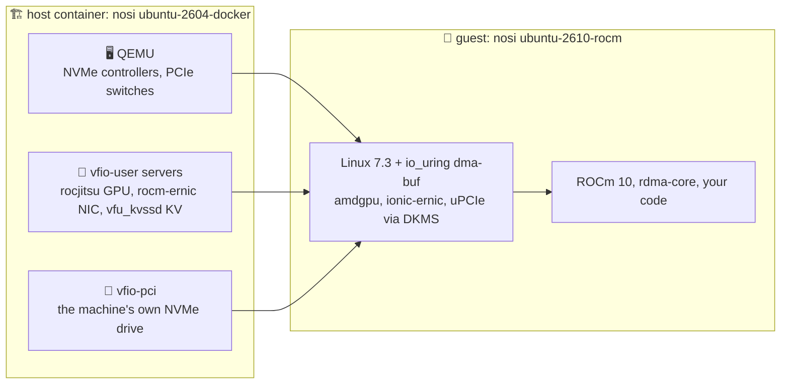
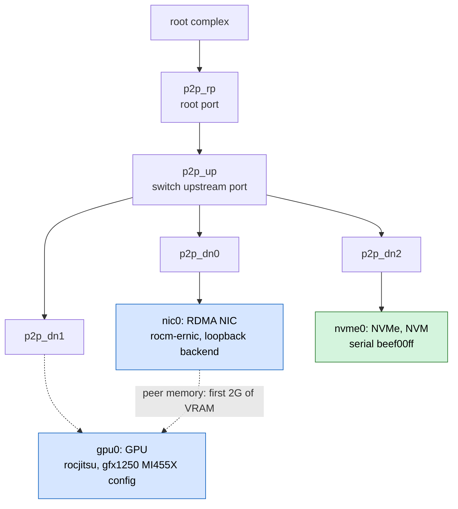
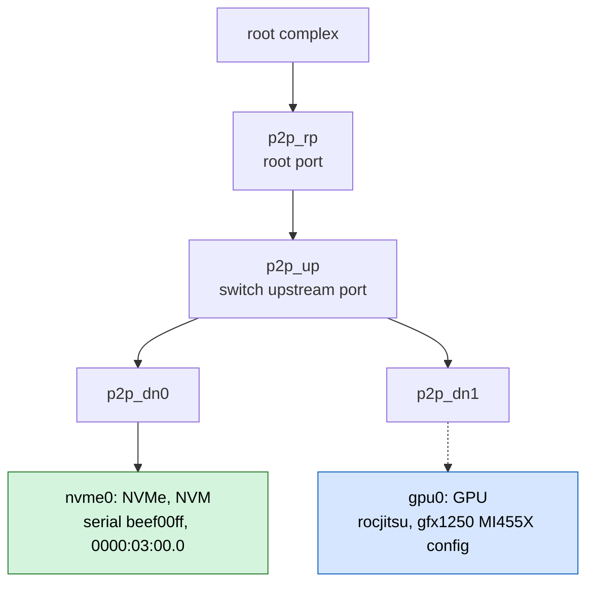
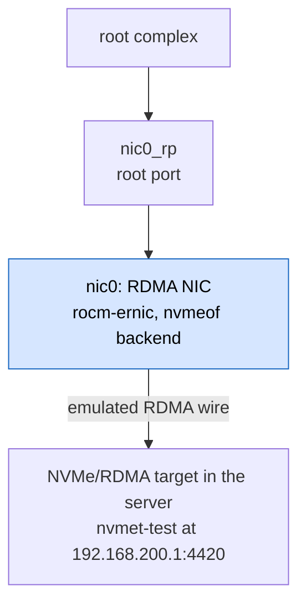
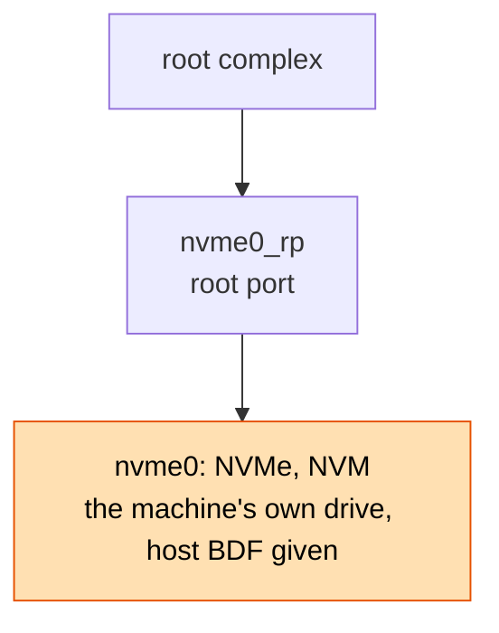
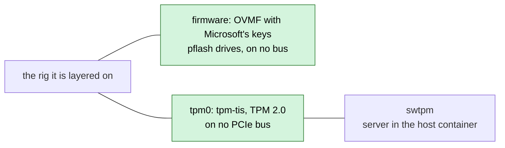

# xnvme-devenv

> *This is my env. There are many like it, but this one is mine.*

A storage and compute lab in two images. Boot a guest with an emulated GPU,
an emulated RDMA NIC and a rack of NVMe controllers. Run it the same way on
your own machine and in CI. No GPU, RDMA NIC or KV drive needed.

## ✨ What you get

Two images, released together. The **host** container emulates the
hardware. The **guest** is the OS your code runs on, booted inside it with
that hardware plugged in.

### 🏗️ The host: what is emulated, and how it gets in

The host is nosi's `ubuntu-2604-docker`, Ubuntu 26.04 LTS as an OCI image,
carrying stock [QEMU](https://www.qemu.org/), OVMF and cijoe, plus the
device servers below. Run it on your laptop or as a GitHub Actions job
container. No GPU, RDMA NIC or KV drive needed.

🚀 **An AMD Pensando RDMA AI NIC.**
[rocm-ernic](https://github.com/safl/rocm-ernic) emulates it over vfio-user,
and its server runs an NVMe/RDMA target at the far end of the wire.

🎮 **An AMD Instinct MI455X.** rocjitsu, from
[rocm-systems](https://github.com/safl/rocm-systems), emulates the gfx1250
GPU over vfio-user, VRAM and all.

💾 **NVMe across the command sets.** Eleven controllers, each at a fixed BDF:

* 📦 NVM, also with a large MDTS
* 🧱 ZNS, with zone random write areas
* 🎯 FDP, in a subsystem with eight reclaim unit handles
* 🔑 KV, served by vfu_kvssd from
  [vfio-user-kvssd](https://github.com/safl/vfio-user-kvssd), as stock QEMU
  has no KV
* 🛡️ end-to-end protection: PI types 1, 2 and 3, extended LBA, 64b guard

🔐 **UEFI Secure Boot and TPM 2.0.** OVMF with Microsoft's keys and a TPM
backed by swtpm, for Windows 11 guests.

🔌 **Three ways a device gets in:**

* 🖥️ **emulated** by QEMU: NVMe controllers, PCIe switches, the TPM
* 🧩 **served over vfio-user** by a server in the host container: rocjitsu,
  rocm-ernic, vfu_kvssd
* 🔧 **passed through with vfio-pci**: the machine's own NVMe drive, in the
  same guest as the emulated rigs, checked by serial and refused when the
  host has it mounted

### 🐧 The guest: the OS your code runs on

The guest this repository ships is derived from nosi's `ubuntu-2610-rocm`,
booting a kernel built for these devices. It is the guest for Linux
development against the emulated GPU and NIC. It is not the only guest the
rigs boot; see [Your guest, our rig](#-your-guest-our-rig).

🐧 **Linux 7.3 with the io_uring dma-buf series**, from
[safl/linux](https://github.com/safl/linux) (`xnvme-ci/v7.3-2`), so io_uring
reads and writes straight into GPU memory. Configured with iommufd and the
vfio-pci device cdev, PCI P2PDMA, dma-buf heaps and udmabuf, and the
NVMe/TCP and NVMe/RDMA initiators and targets.

🧩 **Drivers built by DKMS for that kernel:**

* 🧠 amdgpu, with the GC 12.1 fixes
* 📡 `ionic-ernic`, the RDMA NIC's driver
* 🧪 [uPCIe](https://github.com/safl/upcie) v0.10.4's experimental modules,
  `dmabuf_import` and `iommu_map_pa`

🎛️ **ROCm 10 and the RDMA userspace**, from the Ubuntu archive: `rocm-dev`,
`rocminfo` and `amd-smi`, rdma-core with the ionic provider, and perftest.

🛠️ **nosi's curated toolset.** [nosi](https://github.com/safl/nosi), the
**N**iche **O**perating **S**ystem **I**mages, builds both images with its
headless base: gcc, clang, rustc and zig, meson, ninja, cmake and cargo, gdb
with gdb-dashboard and lldb, perf, strace and valgrind, nvme-cli and
smartmontools, and the vfio, hugepages and IOMMU plumbing for user-space PCI
drivers. See the [catalog](https://safl.dk/nosi).

### 🔗 Together: data paths you can test without the hardware

* ⚡ **NVMe to VRAM.** io_uring moves data between an NVMe drive and the GPU's
  VRAM through dma-buf.
* 🌊 **RDMA into VRAM.** The NIC does RDMA WRITE, READ and SEND into and out
  of VRAM, and its server confirms the bytes went through VRAM, not system
  memory.
* 🧮 **Compute.** A GEMM runs on the emulated GPU through HIP.
* 🚀 **NVMe/RDMA.** The guest's kernel initiator discovers the NIC's target.
* 🌐 **NVMe/TCP.** The guest exports a controller through `nvmet-tcp`,
  connects to it, and reads back through PCIe what it wrote through TCP. It is
  also ready for xNVMe's SPDK tests: hugepages, vfio-pci binding and
  `uio_pci_generic`.

### 🪟 Your guest, our rig

The rigs are not tied to the guest shipped here. A rig adds topology and
devices to whatever guest a consumer boots, and the host container runs it
the same way:

* 🐧 **Linux**: the shipped guest, or any other, such as the Debian 13 guest
  xNVMe verifies its transports on with a stock kernel
* 😈 **FreeBSD**: xNVMe's FreeBSD 14 guest boots on the same NVMe rigs
* 🪟 **Windows**: xNVMe's Windows 11 guest boots on `uefi-secureboot-tpm`,
  layered on a storage rig, for its Secure Boot firmware and TPM 2.0

xNVMe's CI uses all three, so one host container covers its Linux, FreeBSD
and Windows jobs. For Linux development on the emulated GPU and NIC, the
shipped guest is the one to use, and the one the sections above
describe.

✅ **Qualified before it ships.** Every release boots the guest under the
host container and passes the checks on the emulated rigs before either
image is published.

## The images

Nothing is built here from source. Each piece is a deb released by its
producer and pinned by URL and sha256 in `lock.toml`: the `xnvme-ci/*` tags
of the safl forks of rocm-ernic, rocm-systems and linux, and the releases of
upcie and vfio-user-kvssd. `lock.toml` is a cijoe config, so the tasks read
the pins from it directly.

| Image | What |
| ----- | ---- |
| guest | nosi's `ubuntu-2610-rocm` booting our kernel, 7.3 with the io_uring dma-buf series, and the guest drivers built for it by DKMS: `ionic-ernic`, the amdgpu GC 12.1 fixes and upcie's modules, plus the rocjitsu firmware stubs and options |
| host  | nosi's `ubuntu-2604-docker`, which has stock QEMU and cijoe, with the vfio-user servers: rocm-ernic, rocjitsu, vfu_kvssd |

The two are released together under one tag, because what breaks silently
crosses between them: the rocm-ernic server and its guest driver, rocjitsu
and its firmware, our kernel and the modules built for it. xNVMe pins one tag
for both.

The guest is for CI only and is never flashed onto a machine, so it may
carry emulation settings that nosi must not. Machines that cannot reboot into
a new kernel install the producers' DKMS debs on their own kernel instead.

How xNVMe uses these environments, in CI and to reproduce a CI job on your
own machine, is in xNVMe's documentation:
[Continuous Integration](https://xnvme.io/contributing/ci/index.html).

## Rigs

A rig is what a guest boots with: its PCIe topology and the devices on it.
Each rig is a cijoe config under `rigs/`, shipped in the host container at
`/opt/xnvme-devenv/rigs`. `cijoe/scripts/rig.py` describes the format. A rig
is named for the machine it stands in for and where its devices come from.

| Rig | Devices |
| --- | ------- |
| `cluster-node-emulated` | GPU, RDMA NIC and an NVMe drive behind one PCIe switch |
| `compute-node-emulated` | GPU and one NVMe controller behind one PCIe switch |
| `storage-node-emulated` | the NVMe controllers xNVMe's QEMU matrix tests, one per command set and format |
| `rdma-node-emulated` | the RDMA NIC alone, its far end an NVMe/RDMA target |
| `storage-node-passthru` | the machine's own NVMe drive, through vfio-pci |
| `uefi-secureboot-tpm` | UEFI firmware with Microsoft's Secure Boot keys and a TPM, layered on another rig |

### Topologies

How the two images fit together, whatever the rig:

Drawn from the rig files. Each switch and each device without a `port` sits
on a root port of its own, named as `rig.py` names it. Green is emulated by
QEMU, blue is served over vfio-user, orange is passed through with vfio-pci.
A dashed arrow from a port is a device plugged after boot.

`cluster-node-emulated`:

`compute-node-emulated`:

`storage-node-emulated`, with the controllers at 0000:01:00.0 to
0000:0b:00.0 in the order shown:

```mermaid
flowchart TD
  rc["root complex"]
  rc --> nvme0_rp["nvme0_rp"] --> nvme0["nvme0: NVMe, NVM<br/>beef0000"]:::qemu
  rc --> nvme1_rp["nvme1_rp"] --> nvme1["nvme1: NVMe, ZNS with ZRWA<br/>beef0001"]:::qemu
  rc --> nvme2_rp["nvme2_rp"] --> nvme2["nvme2: NVMe, KV<br/>vfu_kvssd"]:::vfiouser
  rc --> nvme3_rp["nvme3_rp"] --> nvme3["nvme3: NVMe, NVM, for NVMe/TCP<br/>beef0003"]:::qemu
  rc --> nvme4_rp["nvme4_rp"] --> nvme4["nvme4: NVMe, NVM, large MDTS<br/>beef0004"]:::qemu
  rc --> nvme5_rp["nvme5_rp"] --> nvme5["nvme5: NVMe, FDP<br/>beef0005"]:::qemu
  rc --> nvme6_rp["nvme6_rp"] --> nvme6["nvme6: NVMe, NVM, PI type 1<br/>beef0006"]:::qemu
  rc --> nvme7_rp["nvme7_rp"] --> nvme7["nvme7: NVMe, NVM, PI type 2<br/>beef0007"]:::qemu
  rc --> nvme8_rp["nvme8_rp"] --> nvme8["nvme8: NVMe, NVM, PI type 3<br/>beef0008"]:::qemu
  rc --> nvme9_rp["nvme9_rp"] --> nvme9["nvme9: NVMe, NVM, PI type 1, extended LBA<br/>beef0009"]:::qemu
  rc --> nvme10_rp["nvme10_rp"] --> nvme10["nvme10: NVMe, NVM, PI type 1, 64b guard<br/>beef0010"]:::qemu
  nvme5_subsys["nvme5_subsys: nvme-subsys, FDP on<br/>on no bus"]:::qemu -.- nvme5
  classDef qemu fill:#d4f4dd,stroke:#2e7d32,color:#000
  classDef vfiouser fill:#d6e6ff,stroke:#1565c0,color:#000
```

`rdma-node-emulated`:

`storage-node-passthru`:

`uefi-secureboot-tpm` adds nothing to PCIe. It is layered on another rig:

The `rig_*` scripts in `cijoe/scripts` start a guest with a rig, plug and
unplug its devices, and kill it with its servers. They install as the cijoe
package `xnvme_devenv`, with the devbind and iommu they pass devices through
with. A consumer adds them to its cijoe with
`pipx inject <venv> /opt/xnvme-devenv/cijoe` in the host container, or from
a checkout on any other host, and uses them as
`xnvme_devenv.rig_guest_start` and so on.

Once the guest is up, cijoe's `core.facts_gather` records its NVMe
controllers, GPUs and NICs as facts under the guest's target name. The
consumer's steps read them as `{{ target.nvme }}`, `{{ target.gpu }}` and
`{{ target.nic }}`, and a later run with `--facts <output>/facts.toml`. A
consumer finds a device by what the rig fixes, an NVMe controller's serial
or a function's BDF, and pairs it with the device's labels from the rig. Its
device list then does not depend on how the guest numbers its devices.

`storage-node-passthru` needs the drive's BDF, from `PASSTHRU=<bdf>` or from
a config of the machine's, which may also give the serial to check. The host
container needs `--privileged --ulimit memlock=-1`. CI has no drive to pass
through, so `make qualify-passthru PASSTHRU=<bdf>` qualifies the rig on a
machine that has one.

`uefi-secureboot-tpm` stands in for no machine. It is layered on another rig,
as in `RIG="storage-node-passthru uefi-secureboot-tpm"`. The Windows image is
the machine's own. Windows is not ours to publish, so no release carries one,
and CI, which has none, does not qualify the rig.

`make qualify-cluster RIG=...` takes rig names or paths to rig files. Each is
one more config, and later ones win, so a file of your own can change one
detail of a rig without copying it.

## Qualifying

Each check has a make target and a cijoe report of its own. All but
`qualify-passthru` run in CI.

| Target | Checks |
| ------ | ------ |
| `make qualify-cluster` | our kernel, GEMM, NVMe to dma-buf and VRAM over io_uring, RDMA into and out of VRAM |
| `make qualify-compute` | the GPU comes up, the NVMe controller at its BDF, NVMe to dma-buf and VRAM, GEMM |
| `make qualify-pcie` | the storage rig's controllers over PCIe, with the guest's vIOMMU and without |
| `make qualify-tcp` | one controller through the kernel's NVMe/TCP target and back, and what xNVMe's tcp-spdk tests need of the guest |
| `make qualify-rdma` | the guest's NVMe/RDMA initiator discovers the RDMA rig's target |
| `make qualify-passthru` | the machine's own drive, passed through |

## Making a release

`make host ci WORKDIR=<dir>` builds the host container, then derives and
qualifies the guest inside it. Each step is a cijoe task under `cijoe/tasks`
with its own report. `make host` needs cijoe installed
(`pipx install ./cijoe --include-deps`). It is the same line
`.github/workflows/ci.yml` runs on every push, so a CI failure reproduces
locally with it. `<dir>` needs some 45G free. `make logs WORKDIR=<dir>`
prints the ends of the guests' consoles and the servers' logs afterwards.

Deriving the guest is most of a run, so it is done only for inputs no
published guest was made from. `make derive` hashes the guest's part of the
lock, its nosi base, kernel and debs, and what derive runs. When a guest
tagged `inputs-<hash>` is published, it stages that guest and qualifies it;
`REUSE=0` derives regardless. A guest staged so carries the lock of the
release that made it, whose host pins may be older. The release's own lock
is attached to it.

A release is a commit on main that changes `VERSION`, with the subject
`ver: bump to vX.Y.Z`. When CI on main is green and no tag `vX.Y.Z` exists
yet, the same run publishes the host as
`ghcr.io/xnvme/xnvme-devenv/host:vX.Y.Z` and the guest, with the lock it was
made from, as `ghcr.io/xnvme/xnvme-devenv/guest-ubuntu-2610:vX.Y.Z` and
`:inputs-<hash>`. A guest staged from an earlier release is tagged again
rather than pushed. The run then creates the tag with a GitHub release that
names both, with the lock, the guest image's sha256 and the cijoe reports
attached. Nobody pushes a tag by hand.

A consumer pins the host and the guest by the same version tag,
`oras://ghcr.io/xnvme/xnvme-devenv/guest-ubuntu-2610:vX.Y.Z` for the guest,
which cijoe stages once. The release names the guest's layer digest too, for
pinning the bytes themselves.

## Licensing

BSD-3-Clause (`LICENSE`), except where a file says otherwise:
`guest/tests/rdma_p2p.hip` is GPL-2.0-or-later, following rocm-ernic's tests.
